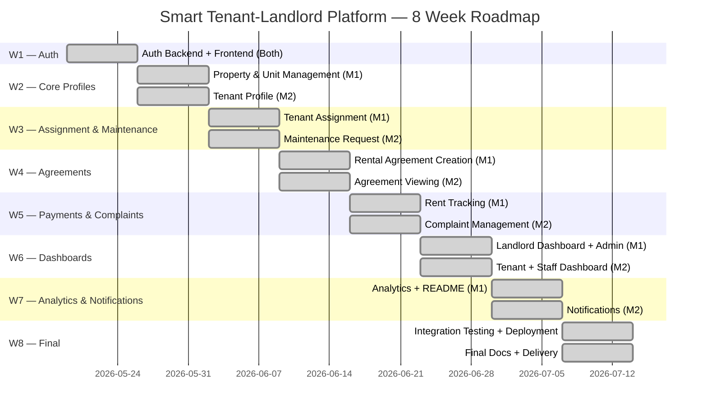

# Project Roadmap

This document outlines the 8-week sprint timeline for the Smart Tenant-Landlord Management Platform. Each sprint is organized by issue, owner, and deliverables. The roadmap reflects the actual development sequence followed by the team.

---

## Timeline Overview

---

## Sprint Details

### Week 1 — Authentication (Both Members)

| Issue | Owner | Deliverables |
|-------|-------|-------------|
| #01 Auth Backend + Frontend | Both | Register, login, logout, token refresh endpoints; AuthContext; LoginPage; RegisterPage; ProtectedRoute |

**Outcome:** All four roles can register and log in. JWT access + refresh token flow working. Frontend protected routes redirect unauthenticated users.

---

### Week 2 — Core Property and Profile (M1 + M2)

| Issue | Owner | Deliverables |
|-------|-------|-------------|
| #03 Property & Unit Management | M1 (Sadman) | 10 CRUD endpoints for properties and units; landlord dashboard with Cloudinary image upload |
| #04 Tenant Profile | M2 (Zainab) | Tenant profile auto-creation; profile view and edit; Cloudinary photo upload |

**Outcome:** Landlord can manage properties and units. Tenant can view and update their profile.

---

### Week 3 — Assignment and Maintenance (M1 + M2)

| Issue | Owner | Deliverables |
|-------|-------|-------------|
| #05 Tenant Assignment | M1 (Sadman) | 8 endpoints; assign tenants to units; conflict enforcement; occupancy badges on unit cards |
| #06 Maintenance Request | M2 (Zainab) | 9 endpoints; tenant submission; landlord management; staff assignment; staff work status update |

**Outcome:** Landlord can assign tenants to units. Tenants can submit maintenance requests. Staff can view and update their work.

---

### Week 4 — Rental Agreements (M1 + M2)

| Issue | Owner | Deliverables |
|-------|-------|-------------|
| #07 Rental Agreement Creation | M1 (Sadman) | 7 endpoints; draft/activate/delete lifecycle; landlord agreement management |
| #08 Agreement Viewing & Acceptance | M2 (Zainab) | Tenant view agreements; accept active agreements; `tenant_accepted_at` field |

**Outcome:** Full two-party agreement signing flow — landlord creates and activates, tenant accepts.

---

### Week 5 — Payments and Complaints (M1 + M2)

| Issue | Owner | Deliverables |
|-------|-------|-------------|
| #09 Rent Tracking | M1 (Sadman) | 8 endpoints; landlord creates payment records; tenant Pay Now flow; payment history |
| #10 Complaint Management | M2 (Zainab) | 7 endpoints; tenant submit and delete; landlord respond and update status |

**Outcome:** Full rent payment lifecycle including tenant self-payment. Tenant complaints with landlord response threading.

---

### Week 6 — Dashboards and Admin (M1 + M2)

| Issue | Owner | Deliverables |
|-------|-------|-------------|
| #11 Landlord Dashboard + Admin Panel | M1 (Sadman) | Aggregated landlord stats; admin user management; admin property listing; platform stats |
| #12 Tenant + Staff Dashboard | M2 (Zainab) | Tenant stats dashboard with quick actions; staff workload summary with assignment split |

**Outcome:** All four roles have meaningful dashboard home pages. Admin can manage users and view platform-wide data.

---

### Week 7 — Analytics and Notifications (M1 + M2)

| Issue | Owner | Deliverables |
|-------|-------|-------------|
| #13 Analytics + README Doc | M1 (Sadman) | 5 Recharts charts (revenue, payments, maintenance, occupancy, complaints); docs README |
| #14 Notifications | M2 (Zainab) | Send notifications; mark read; preferences toggles; notification history |

**Outcome:** Landlord can view analytics charts. All users receive and manage in-app notifications.

---

### Week 8 — Integration Testing and Final Delivery (Both)

| Issue | Owner | Deliverables |
|-------|-------|-------------|
| #15 Integration Testing + Bug Fixes | Both | Full end-to-end testing; 80 test cases executed; bug fixes; production deployment |
| #16 Final Docs + Delivery | Both | Test plan, test cases, traceability matrix, risk analysis, roadmap, signoff, infrastructure architecture |

**Outcome:** Platform fully deployed on Vercel + Render + Supabase. All 80 test cases passed. Complete documentation delivered.

---

## Milestone Summary

| Milestone | Target | Status |
|-----------|--------|--------|
| Auth working for all roles | End of W1 | ✅ Achieved |
| Core landlord + tenant features | End of W2 | ✅ Achieved |
| Assignment + maintenance flow | End of W3 | ✅ Achieved |
| Agreement signing complete | End of W4 | ✅ Achieved |
| Payment + complaint complete | End of W5 | ✅ Achieved |
| All dashboards live | End of W6 | ✅ Achieved |
| Analytics + notifications | End of W7 | ✅ Achieved |
| Production deployment | W8 | ✅ Achieved |
| All documentation delivered | W8 | ✅ Achieved |

---

## Technology Decisions Timeline

| Week | Decision | Rationale |
|------|----------|-----------|
| W1 | JWT with refresh tokens | Secure, stateless auth suitable for multi-role SPA |
| W1 | FastAPI + SQLAlchemy + Alembic | Type-safe, fast, production-grade Python stack |
| W2 | Cloudinary for image storage | Free tier, easy unsigned upload preset, CDN delivery |
| W2 | Vite proxy for API calls | Avoids CORS in dev; production uses Vercel rewrites |
| W7 | Recharts for analytics | Already available in React environment; no extra bundle cost |
| W8 | Render for backend | Auto-deploy from GitHub; replaced Railway after its trial expired |
| W8 | Vercel for frontend | Zero-config Vite deployment, auto-deploy on push |
| W8 | Supabase for database | Managed PostgreSQL, free tier, session pooler for connection pooling |